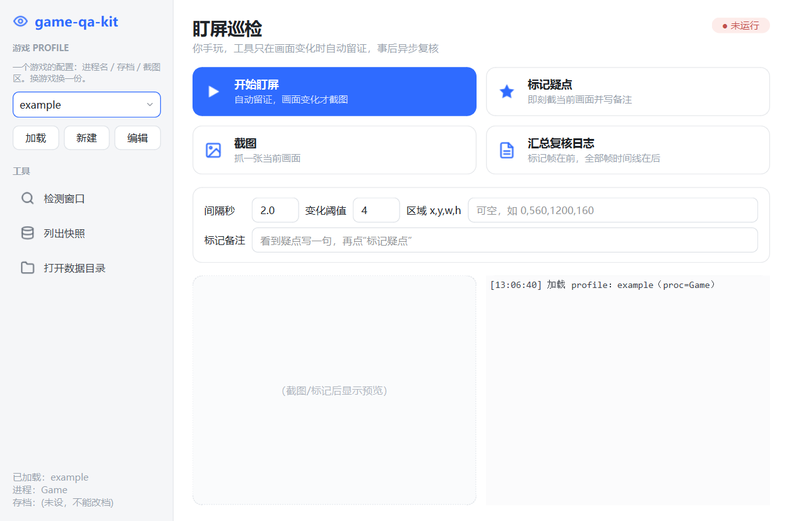

<div align="center">

# game-qa-kit

游戏截图、疑点标记与 AI 测试工具

[**下载程序**](https://github.com/galact-byte/game-qa-kit/releases/latest) · [MCP 接入指南](docs/MCP.md) · [支持哪些游戏](docs/ENGINE-COVERAGE.md)

</div>

给游戏开发者、测试人员和汉化校对者使用。正常玩游戏时自动留图，看到问题随手标记，结束后按时间线复核；也可以接入 AI 客户端，让 AI 查看画面、整理记录，操作已适配的游戏。



## 能做什么

| 使用方式 | 可以做的事 |
|---|---|
| 手动测试 | 按画面变化留图，为疑点添加截图和备注，汇总复核日志 |
| AI 协助 | 通过 MCP 查看游戏画面、读取疑点记录、整理测试结果 |
| AI 后台操作 | 接入支持的游戏后，移动、操作菜单、暂停，并查看操作后的画面 |

人工盯屏可以直接使用。AI 后台操作需要对应的游戏桥和组件，兼容范围见下文。

## 下载后开始使用

1. 从 [Releases](https://github.com/galact-byte/game-qa-kit/releases/latest) 下载 Windows x64 ZIP，完整解压，打开 **`GameQA/GameQA.exe`**。不需要安装 Python。
2. 打开游戏，在主程序中点「新建」，从运行中的程序列表选择游戏，保存并加载配置。
3. 点「开始盯屏」，切回游戏正常玩。发现问题时，填写备注并点「标记疑点」。
4. 结束后停止盯屏，等停止完成，再点「汇总复核日志」。

记录保存在配置的「QA 数据目录」，可从侧栏打开。便携版默认使用程序旁的 `data/<配置名称>/`，配置文件在 `profiles/`。

请保留完整解压目录，EXE 需要旁边的 `_internal`。升级时解压到新目录，再迁移自己的 `profiles/` 和 `data/`；配置中另行指定的数据目录继续使用原路径。

## macOS 与 Linux

从 [Releases](https://github.com/galact-byte/game-qa-kit/releases/latest) 按系统和芯片下载 x64 或 arm64 程序包。macOS 解压后打开 `GameQA.app`；Linux 解压后打开 `GameQA/GameQA`，无需安装 Python。

这些平台可使用配置读写、存档快照、已有证据复核和公共 MCP 工具。游戏窗口采集、持续盯屏与引擎后台控制目前仍限 Windows。

macOS 包采用临时签名，尚未获得开发者签名或公证。Linux x64 要求 glibc 2.35 或更新版本，arm64 要求 glibc 2.39 或更新版本；较旧系统、Wayland 和日常桌面使用尚未验证。下载、数据目录和兼容范围见[跨平台说明](docs/UNIVERSAL-BUILD.md)。

## 让 AI 调用

便携包内有两个入口：

- **`GameQA.exe`**：双击打开主界面。
- **`GameQA-MCP.exe`**：填入 AI 客户端的 MCP 配置，由客户端自动启动，无需手动打开，也不必同时运行主界面。

下面是常见的 MCP 配置格式，把 `command` 改成实际解压路径：

```json
{
  "mcpServers": {
    "gameqa": {
      "command": "E:/Apps/GameQA/GameQA-MCP.exe"
    }
  }
}
```

配置好后重新连接 MCP。游戏配置、工具用法和源码启动方式见 [MCP 接入指南](docs/MCP.md)。

需要 AI 操作游戏时，从主程序的「AI 后台接入」开始：选择游戏与所需组件，检查准备摘要，确认后启动测试副本。接入步骤见 [游戏接入说明](docs/GAME-ADMISSION.md)。

## 游戏兼容范围

截图能否在后台正常更新，取决于游戏和窗口状态。最小化或后台停帧可能导致采集失败。

后台控制已在 RPG Maker MV／MZ、VX Ace、Unity、Wolf RPG、HSP3、SRPG Studio 和 DuckStation 的指定版本或样本上验证过。另有 EasyRPG 等引擎的固定自写样本受管入口，覆盖范围以表内记录为准。**支持某个引擎，不代表该引擎的所有游戏都能接入。** 不同游戏需要的组件、可执行的操作也有区别。

接入前请查看 [引擎覆盖表](docs/ENGINE-COVERAGE.md)；准备组件和操作步骤见 [游戏接入说明](docs/GAME-ADMISSION.md)。

使用时还需留意：

- 人工盯屏不主动抢焦点。MCP 中的桌面点击／按键使用前台输入，后台操作请使用已接入的控制桥。
- 自动疑点需要人工复核，没有疑点记录也不代表游戏没有问题。
- 普通截图和标记无需模型。画面正文识别需另配 OCR；工具不自动下载模型或安装额外依赖。

## 从源码运行

安装 Python 和项目依赖，在仓库目录执行：

```bash
python -m pip install -r requirements.txt
python -m gameqakit.gui
```

也可以使用仓库中的 `start.bat`。开发、测试和打包说明见下方文档。

## 文档

- [MCP 接入指南](docs/MCP.md) · [游戏接入说明](docs/GAME-ADMISSION.md)
- [引擎覆盖表](docs/ENGINE-COVERAGE.md) · [后台控制说明](docs/BACKGROUND-CONTROL.md)
- [开发与测试](docs/DEVELOPMENT.md) · [Windows 打包](docs/PACKAGING.md)
- [迭代路线](docs/ROADMAP.md) · [修改记录](CHANGES.md)

## 许可证

项目代码使用 [MIT](LICENSE) 许可证。第三方组件遵循各自许可，见 [第三方组件说明](tools/THIRD-PARTY.md)。
