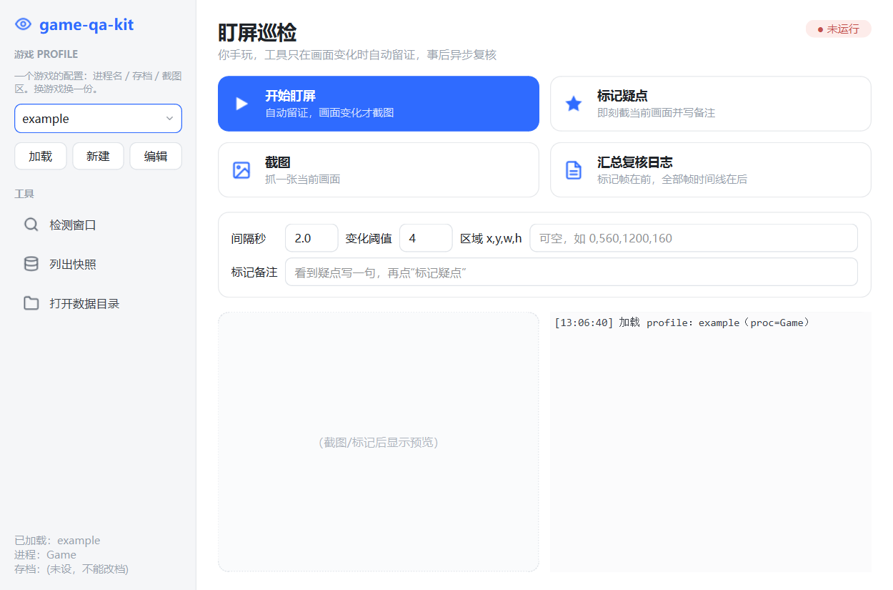

# game-qa-kit

游戏测试时自动留图、标记疑点、整理复核记录的 Windows 工具，配套 MCP 可供 AI 调用。



## 开始使用

首次使用需安装 Python 和依赖：

```bash
python -m pip install -r requirements.txt
```

1. 双击 `start.bat` 打开控制台。
2. 新建游戏配置（profile），从运行中的程序列表选择游戏，自动读取信息后保存并加载；也可手动填写。
3. 打开游戏，点「开始盯屏」，切回游戏正常玩。
4. 需要时点「标记疑点」，或用「查看自动疑点」优先复核候选。
5. 玩完停止盯屏，等停止完成后点「汇总复核日志」。

默认使用窗口标题筛选，无需模型。需要识别画面正文时，可选 OCR 模式；
它需要额外的本地 OCR 依赖，未安装时会提示降级，不影响普通留图。

## 记录在哪里

保存在游戏配置的「QA 数据目录」中，可从侧栏打开。未设置时默认在
`~/.gameqakit/<配置名称>/`。

每次盯屏单独保存：普通留图、人工标记、自动疑点原图及依据，以及 `复核日志.txt`。
旧记录不会因为停止会话而删除。

## 使用前请留意

- **自动疑点只是候选，不是已确认缺陷。** 没有疑点也不代表没有问题。
- 窗口后台截图是否可用取决于游戏；最小化、后台停帧等情况可能导致采集失败或遗漏。
- 盯屏不主动抢焦点；旧 MCP 点击/按键仍可能抢前台。实验后台控制需接入对应插件，兼容范围见 [后台控制说明](docs/BACKGROUND-CONTROL.md)。
- 工具不自动下载 YOLO、OCR 模型或安装额外依赖。

## AI 后台操作（实验）

人工盯屏可按上面的步骤直接使用。AI 后台操作需先在测试副本接入对应引擎桥，
再通过统一 MCP 连接和发送动作。当前还没有将任意游戏一键转为后台控制的入口。

| 引擎／环境 | 已验范围摘要 |
|---|---|
| RPG Maker MV／MZ | SDK 工程的真实移动、菜单和暂停 |
| RPG Maker VX Ace | SDK 与指定商业副本的读档、位移、菜单和暂停 |
| Unity | Mono 旧 Input、新 Input System、IL2CPP／新输入及 Mono／Rewired 分别适配；已验范围因后端和样本而异，见[覆盖表](docs/ENGINE-COVERAGE.md) |
| Wolf RPG | 两个固定构建；官方范例移动、菜单和战斗，商业构建移动、菜单、存读档及短时重复操作 |
| HSP3 | 官方空白工程输入与点击；八星帝外置字节码的标题／读取菜单 |
| DuckStation／PS1 | 一个固定模拟器构建；指定游戏移动、存读档和首战 |

**常见引擎尚未全部适配。** XP／VX 等目前只有识别；Godot、Unreal、Ren'Py 等尚无已验控制通路。
已列引擎也仅覆盖登记的构建和样本，不代表任意游戏兼容或已通过全流程、长期稳定性测试。

接入步骤见[后台控制说明](docs/BACKGROUND-CONTROL.md)，完整边界见[引擎覆盖表](docs/ENGINE-COVERAGE.md)。
基础适配按后台运行、输入隔离、新画面、真实操作与暂停释放收口；战斗、存读档、全流程等按具体任务追加验证。
独立 Win32 Desktop 不隔离文件系统或存档，虚拟机／Sandbox 兜底仍处于环境核查阶段。

## 进一步了解

- [AI / MCP 接入](docs/MCP.md)
- [开发与验证](docs/DEVELOPMENT.md)
- [引擎覆盖与未验范围](docs/ENGINE-COVERAGE.md)
- [暂定迭代路线](docs/ROADMAP.md)
- [已测 Wolf RPG 实验控制桥](plugins/wolf/README.md)
- [修改记录](CHANGES.md)

## 许可证

[MIT](LICENSE)
